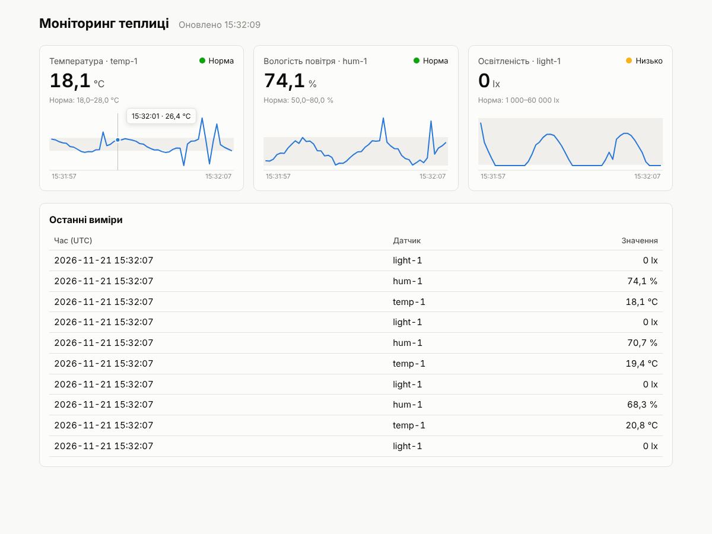

# MPP_STEM — Інтелектуальна система моніторингу теплиці

Навчальний проєкт з МПП. Система збирає покази датчиків температури, вологості
повітря та освітленості, зберігає їх у базі даних, порівнює з нормою для рослин
і показує все на вебдашборді.



## Архітектура

```
┌──────────────────┐  POST /api/readings/batch  ┌─────────────────┐     ┌──────────┐
│ Симулятор        │ ─────────────────────────▶ │ Бекенд FastAPI  │ ──▶ │ SQLite   │
│ датчиків (Python)│                            │ (REST API)      │ ◀── │          │
└──────────────────┘                            └────────┬────────┘     └──────────┘
                                                         │ GET /api/...
                                                ┌────────▼────────┐
                                                │ Дашборд (HTML,  │
                                                │ JS, без збірки) │
                                                └─────────────────┘
```

## Структура репозиторію

| Шлях | Що там |
|---|---|
| `app/` | Бекенд: `main.py` (маршрути API), `db.py` (схема БД і запити), `models.py` (валідація даних), `alerts.py` (оцінка «норма / низько / високо»), `config.py` (типи датчиків і пороги) |
| `simulator/` | Симулятор датчиків з добовим циклом і випадковими аномаліями |
| `dashboard/` | Сторінка дашборда (`index.html`, `app.js`, `style.css`), бекенд роздає її сам |
| `tests/` | Автотести pytest для API і симулятора |
| `.github/workflows/ci.yml` | CI: ruff + тести з покриттям на Ubuntu і Windows |

## Як запустити

Потрібен Python 3.11 або новіший.

**1. Встановити залежності** (один раз):

```bash
python -m venv .venv
# Linux / macOS:
source .venv/bin/activate
# Windows (PowerShell):
.venv\Scripts\Activate.ps1

pip install -r requirements-dev.txt
```

**2. Запустити бекенд** (у першому терміналі):

```bash
uvicorn app.main:app --reload
```

Під час першого запуску створюється файл `greenhouse.db` з трьома датчиками:
`temp-1`, `hum-1`, `light-1`.

**3. Запустити симулятор** (у другому терміналі, з тим самим активованим `.venv`):

```bash
python -m simulator.sensor_simulator
```

Корисні параметри: `--interval 1` (секунд між пакетами), `--speed 600`
(прискорення часу, 600 означає добу за 2,4 хв), `--anomaly-rate 0.05` (частка
аномальних показів), `--seed 42` (відтворюваний результат), `--count 100`
(зупинитися після 100 пакетів).

**4. Відкрити дашборд:** http://127.0.0.1:8000/

Документація API (Swagger) доступна за адресою http://127.0.0.1:8000/docs

## API

| Метод | Шлях | Опис |
|---|---|---|
| GET | `/api/health` | Перевірка, що сервер працює |
| GET | `/api/sensors` | Список датчиків з одиницями та нормою |
| POST | `/api/readings` | Додати один вимір `{"sensor": "temp-1", "value": 23.5}` |
| POST | `/api/readings/batch` | Додати пакет вимірів (усі або жодного) |
| GET | `/api/readings?sensor=temp-1&limit=100` | Останні виміри, новіші першими |
| GET | `/api/readings/latest` | Останній вимір кожного датчика і його статус |

## Тести і статичний аналіз

```bash
ruff check .                              # статичний аналіз
pytest --cov --cov-report=term-missing    # тести зі звітом про покриття
```

Ті самі команди виконує GitHub Actions для кожного PR на Ubuntu і Windows.

### Крайні випадки, які покривають тести

1. Невідомий датчик → `404`, нічого не записується.
2. Значення поза фізичним діапазоном (вологість 101 %, температура −41 °C) → `422`;
   граничні значення (0 % і 100 %) приймаються.
3. Нечислове або відсутнє значення → `422`.
4. Пакет, у якому хоч один вимір некоректний, не записується зовсім (транзакція).
5. Датчик без жодного виміру показується зі статусом «Немає даних».
6. Спроба SQL-ін'єкції в назві датчика нічого не ламає (параметризовані запити).
7. Час з іншим часовим поясом приводиться до UTC.

## База даних

Схема в третій нормальній формі: `sensor_types` (одиниця і діапазони для типу
датчика) → `sensors` (конкретні датчики) → `readings` (виміри). Є первинні й
зовнішні ключі, обмеження `CHECK` і `UNIQUE`, індекс `(sensor_id, recorded_at)`
для вибірок за датчиком і часом. Усі запити параметризовані.

## Припущення

Ці рішення прийнято для каркаса, їх можна змінити:

- **Стек:** Python + FastAPI + SQLite, дашборд на чистому HTML/JS без збірки,
  щоб проєкт запускався однією командою на будь-якій ОС без Node.js чи сервера БД.
- **Справжніх датчиків немає**, дані генерує симулятор. Коли з'явиться
  мікроконтролер (наприклад, ESP32), він надсилатиме ті самі JSON-запити.
- **Норми для рослин** орієнтовні (типові для овочевих культур): температура
  18–28 °C, вологість 50–80 %, освітленість 1 000–60 000 лк. Вони задаються в
  `app/config.py`. Уночі освітленість очікувано має статус «Низько».
- **Час** зберігається в UTC.
- **Автентифікації немає**, сервер призначено для локальної мережі.

## Що далі

- Сповіщення (Telegram або email), коли показ довго поза нормою.
- Кілька зон теплиці і кілька датчиків кожного типу.
- Керування поливом, вентиляцією й освітленням за правилами.
- Підключення справжніх датчиків.
