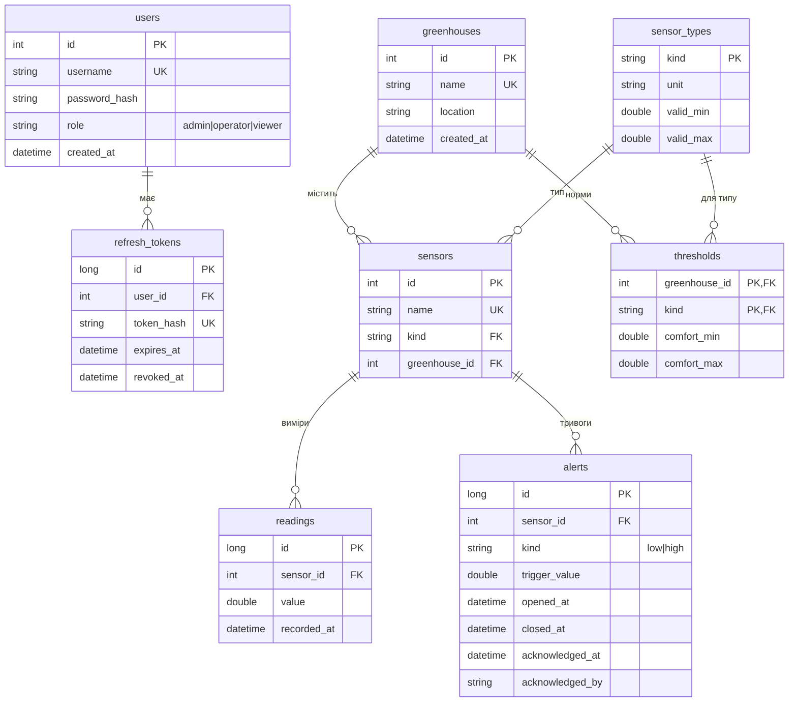

# Greenhouse Monitor — Інтелектуальна система моніторингу теплиці

[](https://github.com/Maksim380/MPP_STEM_M/actions/workflows/ci.yml)

Навчальний STEM-проєкт з дисципліни «Мультиплатформне програмування» (.NET 10).
Система збирає покази датчиків температури, вологості повітря й освітленості з кількох теплиць,
зберігає їх у базі даних, порівнює з нормою кожної теплиці, відкриває тривоги, коли показ виходить
за межі, і показує все на вебдашборді в реальному часі (SignalR). Доступ розмежовано ролями,
пристрої пишуть дані за API-ключем.


## Зміст

- [Архітектура проєкту](#архітектура-проєкту)
- [Архітектура бази даних (ER-діаграма)](#архітектура-бази-даних-er-діаграма)
- [Технологічний стек](#технологічний-стек)
- [Функціональні модулі та компоненти](#функціональні-модулі-та-компоненти)
- [REST API ендпоінти](#rest-api-ендпоінти)
- [Встановлення та запуск](#встановлення-та-запуск)
- [Контейнеризація (Docker)](#контейнеризація-docker)
- [Тестування та CI/CD](#тестування-та-cicd)
- [Відповідність критеріям захисту](#відповідність-критеріям-захисту)
- [Процес розробки](#процес-розробки)

## Архітектура проєкту

```
MPP_STEM_M/
├── src/
│   ├── Greenhouse.Core/        # Ядро: доменні правила, сутності, DbContext і міграції, сервіси, безпека
│   │   ├── Domain/             #   норми, правило тривог, ролі, генератор сигналів
│   │   ├── Data/               #   EF Core: модель, контексти SQLite/PostgreSQL, міграції
│   │   ├── Services/           #   ReadingService, AlertService, GreenhouseService, UserService
│   │   └── Security/           #   PBKDF2-хешування паролів, refresh-токени
│   ├── Greenhouse.Api/         # Веб-шар: Minimal API, JWT/API-ключ, SignalR-хаб, фоновий симулятор
│   │   ├── Endpoints/          #   маршрути /api/auth, /users, /greenhouses, /readings, /alerts
│   │   ├── Realtime/           #   TelemetryHub і сповіщення клієнтів
│   │   ├── Background/         #   SimulatorWorker (BackgroundService + PeriodicTimer)
│   │   └── wwwroot/            #   дашборд (HTML/CSS/JS без збірки)
│   └── Greenhouse.Simulator/   # Консольний «пристрій»: надсилає покази в API як справжній датчик
├── tests/Greenhouse.Tests/     # xUnit: юніт- та інтеграційні тести (WebApplicationFactory)
├── docs/                       # Документи для захисту: тест-кейси, крайні випадки, БД, якість, лог рішень
├── .github/workflows/ci.yml    # CI: Ubuntu, Windows, macOS + запуск на SQLite і PostgreSQL + Docker
├── Dockerfile, compose.yaml    # Контейнери: api, simulator, PostgreSQL
└── Greenhouse.sln
```

Шари залежать в одному напрямку: `Api → Core`, `Simulator → Core`. Ядро не знає про HTTP і SignalR:
веб-шар підставляє свою реалізацію `ITelemetryNotifier`, а помилки ядра (`ClientDataException`)
перетворює на коди HTTP в одному місці (`GlobalExceptionHandler`).

```
 Датчик / Simulator ──POST /api/readings/batch (X-Api-Key)──▶ Greenhouse.Api ──▶ ReadingService ──▶ БД
                                                                    │                  │
 Дашборд ◀──── SignalR /hubs/telemetry (readingsAdded, alertsChanged) ◀── ITelemetryNotifier
 Оператор ──JWT──▶ /api/alerts/{id}/ack, /api/greenhouses/{id}/thresholds/{kind}
```

## Архітектура бази даних (ER-діаграма)

Схема в 3НФ, задається моделлю EF Core (`Greenhouse.Core/Data/GreenhouseDbContext.cs`) і міграціями
окремо для SQLite та PostgreSQL. Детально з доказами — [docs/database.md](docs/database.md).



## Технологічний стек

- **Платформа:** .NET 10 LTS, C# 14
- **Бекенд:** ASP.NET Core Minimal API, OpenAPI (`/openapi/v1.json`), ProblemDetails
- **Дані:** Entity Framework Core 10 (Code-First, міграції), SQLite або PostgreSQL (`Database:Provider`)
- **Безпека:** JWT Bearer (access + refresh з ротацією), PBKDF2-SHA256 для паролів, API-ключ для пристроїв,
  ролі admin / operator / viewer, rate limiting на вхід, порівняння секретів за сталий час
- **Реальний час і фон:** SignalR (`TelemetryHub`), `BackgroundService` + `PeriodicTimer`
- **Логування:** Serilog (консоль і файл `logs/greenhouse-*.log`)
- **Фронтенд:** HTML, CSS, JavaScript без збірки, графіки на SVG, клієнт SignalR
- **Тестування:** xUnit, WebApplicationFactory, coverlet, ReportGenerator
- **Якість:** Roslyn-аналізатори (`latest-recommended`, попередження = помилки), `dotnet format`
- **Контейнери і CI:** Docker (multi-stage), Docker Compose, GitHub Actions (Ubuntu, Windows, macOS)

## Функціональні модулі та компоненти

### Теплиці, датчики і норми (`GreenhouseService`)
- Кілька теплиць, у кожної свої датчики і свої пороги норми для кожного типу датчика.
- Нова теплиця автоматично отримує стандартні норми (температура 18–28 °C, вологість 50–80 %, світло 1 000–60 000 лк).
- Норму не можна задати поза фізичним діапазоном датчика або з min > max.

### Прийом телеметрії (`ReadingService`)
- Пакет показів валідується повністю і зберігається в одній транзакції: усе або нічого.
- Відхиляються невідомі датчики (404), неможливі значення і час у майбутньому (422), порожні й зламані дані (400).
- Час приводиться до UTC; історія з фільтрами за датчиком, теплицею і періодом.

### Підсистема тривог (`AlertPolicy`, `AlertService`)
- Тривога — це період: відкривається, коли показ виходить за норму, закривається, коли повертається.
  Поки показ поза нормою, дубліката не буде; стрибок «високо → низько» закриває одну і відкриває іншу.
- Оператор підтверджує тривогу; повторне підтвердження нічого не змінює.

### Користувачі та доступ (`UserService`, `TokenService`)
- Ролі: **admin** керує теплицями, датчиками й користувачами; **operator** підтверджує тривоги і змінює норми;
  **viewer** лише переглядає. Читання даних відкрите для дашборда.
- Access-токен живе 15 хв, refresh-токен 7 днів і змінюється при кожному оновленні. Повторне використання
  старого refresh-токена вважається крадіжкою: відкликаються всі сесії користувача.
- Перший адміністратор створюється з конфігурації під час першого запуску.

### Реальний час (`TelemetryHub`)
- Хаб `/hubs/telemetry` надсилає події `readingsAdded` і `alertsChanged`. Клієнт може підписатися
  на одну теплицю (`Subscribe(greenhouseId)`).

### Симулятори (`SimulatorWorker`, `Greenhouse.Simulator`)
- Генератор сигналів з добовим циклом (вдень тепліше, світліше й сухіше) і випадковими аномаліями.
- Вбудований фоновий сервіс (`Simulator:Enabled=true`) або окремий консольний «пристрій», який ходить в API
  з API-ключем і не падає, коли сервер недоступний.

### Дашборд (`wwwroot`)
- Вибір теплиці, картки з поточним значенням, статусом і графіком, журнал тривог, таблиця останніх вимірів.
- Вхід користувача; оператор бачить кнопки підтвердження тривог і форму зміни норми.

## REST API ендпоінти

Повний опис з прикладами — у OpenAPI: http://localhost:5000/openapi/v1.json. Відповіді в JSON зі snake_case,
помилки у форматі ProblemDetails.

### Автентифікація (`/api/auth`), обмеження спроб — 10 за хвилину з IP

| Метод | Шлях | Доступ | Опис |
|---|---|---|---|
| POST | `/api/auth/login` | усі | Логін і пароль → access + refresh токени |
| POST | `/api/auth/refresh` | усі | Нова пара токенів, старий refresh відкликається |
| POST | `/api/auth/logout` | усі | Відкликати refresh-токен |

### Користувачі (`/api/users`)

| Метод | Шлях | Доступ | Опис |
|---|---|---|---|
| GET | `/api/users` | admin | Список користувачів |
| POST | `/api/users` | admin | Створити користувача з роллю |

### Теплиці (`/api/greenhouses`, `/api/sensors`)

| Метод | Шлях | Доступ | Опис |
|---|---|---|---|
| GET | `/api/greenhouses` | усі | Теплиці з датчиками і нормами |
| GET | `/api/greenhouses/{id}` | усі | Одна теплиця |
| POST | `/api/greenhouses` | admin | Створити теплицю |
| PUT | `/api/greenhouses/{id}` | admin | Змінити назву чи розташування |
| DELETE | `/api/greenhouses/{id}` | admin | Видалити теплицю без датчиків |
| POST | `/api/greenhouses/{id}/sensors` | admin | Додати датчик |
| PUT | `/api/greenhouses/{id}/thresholds/{kind}` | operator, admin | Змінити норму |
| GET | `/api/sensors?greenhouse_id=` | усі | Датчики з одиницями і нормою |

### Телеметрія (`/api/readings`)

| Метод | Шлях | Доступ | Опис |
|---|---|---|---|
| POST | `/api/readings` | пристрій (`X-Api-Key`) | Один вимір `{"sensor":"temp-1","value":23.5}` |
| POST | `/api/readings/batch` | пристрій (`X-Api-Key`) | Пакет вимірів, усі або жоден |
| GET | `/api/readings?sensor=&greenhouse_id=&from=&to=&limit=` | усі | Історія, новіші першими |
| GET | `/api/readings/latest?greenhouse_id=` | усі | Останній вимір кожного датчика і статус |

### Тривоги (`/api/alerts`)

| Метод | Шлях | Доступ | Опис |
|---|---|---|---|
| GET | `/api/alerts?active=&greenhouse_id=&limit=` | усі | Журнал тривог |
| POST | `/api/alerts/{id}/ack` | operator, admin | Підтвердити тривогу |

Також: `GET /api/health` і SignalR-хаб `/hubs/telemetry`.

## Встановлення та запуск

Потрібен **.NET 10 SDK**. Більше нічого встановлювати не треба: за замовчуванням використовується SQLite,
база створюється сама під час першого запуску.

### 1. Встановлення .NET 10 SDK

**Ubuntu 24.04:**
```bash
sudo apt-get update
sudo apt-get install -y dotnet-sdk-10.0
dotnet --version   # 10.0.x
```

**Windows:** `winget install Microsoft.DotNet.SDK.10` (або інсталятор з https://dotnet.microsoft.com/download).

**macOS:** `brew install --cask dotnet-sdk` (або інсталятор з того ж сайту).

### 2. Клонування репозиторію

```bash
git clone https://github.com/Maksim380/MPP_STEM_M.git
cd MPP_STEM_M
```

### 3. Конфігурація

Для локального запуску нічого міняти не треба: значення для розробки лежать у
`src/Greenhouse.Api/appsettings.Development.json`.

| Ключ | Для розробки | Що це |
|---|---|---|
| `Auth:AdminUsername` / `Auth:AdminPassword` | `admin` / `admin12345` | перший адміністратор |
| `Auth:SensorApiKey` | `dev-sensor-key` | ключ пристроїв для запису показів |
| `Auth:JwtSigningKey` | рядок для розробки | секрет підпису JWT, ≥ 32 символи |
| `Database:Provider` | `Sqlite` | `Sqlite` або `Postgres` |
| `ConnectionStrings:Greenhouse` | `Data Source=greenhouse.db` | рядок підключення |
| `Simulator:Enabled` | `false` | вбудований фоновий симулятор |

Поза розробкою секрети задаються змінними середовища (`Auth__JwtSigningKey=...`) або
`dotnet user-secrets`, а не в коді.

### 4. Запуск бекенду

Ubuntu, macOS і Windows — та сама команда:

```bash
dotnet run --project src/Greenhouse.Api --launch-profile http
```

Бекенд слухає http://localhost:5000, дашборд — http://localhost:5000/, OpenAPI — http://localhost:5000/openapi/v1.json.

Щоб одразу бачити живі дані без другого терміналу, увімкніть вбудований симулятор:

```bash
dotnet run --project src/Greenhouse.Api --launch-profile http -- --Simulator:Enabled=true
```

### 5. Запуск симулятора датчиків (другий термінал)

```bash
dotnet run --project src/Greenhouse.Simulator -- --interval 1 --speed 600
```

Параметри: `--api http://localhost:5000`, `--api-key <ключ>` (або змінна `GREENHOUSE_API_KEY`),
`--interval` (секунд між пакетами), `--speed` (600 = доба за 2,4 хв), `--anomaly-rate 0.05`,
`--seed 42`, `--count 100`. Довідка: `--help`.

### 6. Робота з дашбордом

Відкрийте http://localhost:5000/, увійдіть як `admin` / `admin12345`. Адміністратор може створити
оператора через `POST /api/users`, змінювати норму прямо в картці датчика і підтверджувати тривоги.

### 7. PostgreSQL замість SQLite (необов'язково)

```bash
export Database__Provider=Postgres
export ConnectionStrings__Greenhouse="Host=localhost;Database=greenhouse;Username=greenhouse;Password=greenhouse"
dotnet run --project src/Greenhouse.Api --launch-profile http
```

Міграції для PostgreSQL застосуються автоматично.

## Контейнеризація (Docker)

```bash
cp .env.example .env      # змініть паролі та ключі
docker compose up --build
```

Піднімаються три контейнери: `db` (PostgreSQL 16), `api` (дашборд на http://localhost:8080) і
`simulator`. Образ збирається в два етапи (SDK → ASP.NET runtime) і працює не від root; дані
PostgreSQL і логи зберігаються в томах.

## Тестування та CI/CD

```bash
dotnet tool restore
dotnet build -c Release                       # збірка зі статичним аналізом, попередження = помилки
dotnet format --verify-no-changes             # стиль коду
dotnet test --settings coverlet.runsettings --results-directory TestResults
dotnet reportgenerator -reports:"TestResults/*/coverage.cobertura.xml" -targetdir:coverage -reporttypes:"Html;TextSummary"
```

- **147 тестів**: доменні правила, симулятор, REST API, ролі і токени, SignalR, фоновий сервіс, схема БД.
- **Покриття рядків 98 %** (звіт ReportGenerator, код міграцій не враховується). Деталі — [docs/quality.md](docs/quality.md).
- **GitHub Actions** на кожен push і PR:
  1. збірка, `dotnet format`, тести з покриттям на **Ubuntu, Windows і macOS**; збірка падає, якщо покриття < 80 %;
  2. запуск за README на **SQLite і PostgreSQL**: бекенд + симулятор + вхід, перевірка, що в лозі немає `[ERR]`;
  3. збірка Docker-образу.
  HTML-звіт покриття — артефакт `coverage-<ОС>` кожного прогону.

## Відповідність критеріям захисту

За документом «Як захищати проєкт з МПП». Індивідуальні таблиці (B1–B3, D1) — у [docs/defense.md](docs/defense.md).

| Код | Критерій | Де підтвердження |
|---|---|---|
| A2 | Ведення репозиторію | issues [#1–#8](https://github.com/Maksim380/MPP_STEM_M/issues), гілки і PR, коміти з `Refs #N`, лог рішень [docs/decisions.md](docs/decisions.md), цей README |
| B1 | Ланцюг issue → branch → PR → review → merge | [docs/defense.md](docs/defense.md#b1-виконання-індивідуальної-зони-відповідальності), PR [#9](https://github.com/Maksim380/MPP_STEM_M/pull/9) |
| B2 | Хто які задачі закрив і вчасно чи ні | [docs/defense.md](docs/defense.md#b2-виконання-зобовязань-і-комунікація-ризиків) |
| B3 | Результативні code-review (≥ 3) | [docs/defense.md](docs/defense.md#b3-результативність-code-review) |
| C0 | Показ на кількох ОС | запуск за розділом «Встановлення» на Ubuntu і Windows; CI на Ubuntu, Windows, macOS; Docker |
| C1 | Приймальні тест-кейси | [docs/test-cases.md](docs/test-cases.md) — кейси з кроками й автотестами |
| C2 | 5 крайніх випадків і помилки | [docs/edge-cases.md](docs/edge-cases.md) — таблиця «оброблено так/ні» |
| C3 | Автотести, покриття, CI | [docs/quality.md](docs/quality.md), артефакт покриття в Actions |
| C4 | Статичний аналіз | Roslyn-аналізатори, 0 зауважень — [docs/quality.md](docs/quality.md#c4-статичний-аналіз) |
| C5 | Цілісність і безпека даних | [docs/database.md](docs/database.md) — 3НФ, ключі, індекси, параметризація, транзакції |
| D1 | Складність зони | ролі й refresh-токени, транзакції з тривогами, SignalR, фоновий сервіс, дві СУБД |
| E3 | Запуск за README | розділ [Встановлення та запуск](#встановлення-та-запуск); CI-джоба `smoke` повторює ці кроки |

## Процес розробки

1. Задача оформлюється як issue з критеріями готовності.
2. Під неї створюється гілка `feature/<номер>-<коротка-назва>`.
3. Коміти посилаються на issue (`Refs #N`), PR закриває його (`Closes #N`).
4. PR проходить CI і рев'ю іншого учасника; рев'юер залишає суттєві зауваження, автор виправляє.
5. Після схвалення PR зливається в `main`; пряме комітування в `main` не використовується.

Рішення, ухвалені під час розробки, записуються в [docs/decisions.md](docs/decisions.md).
